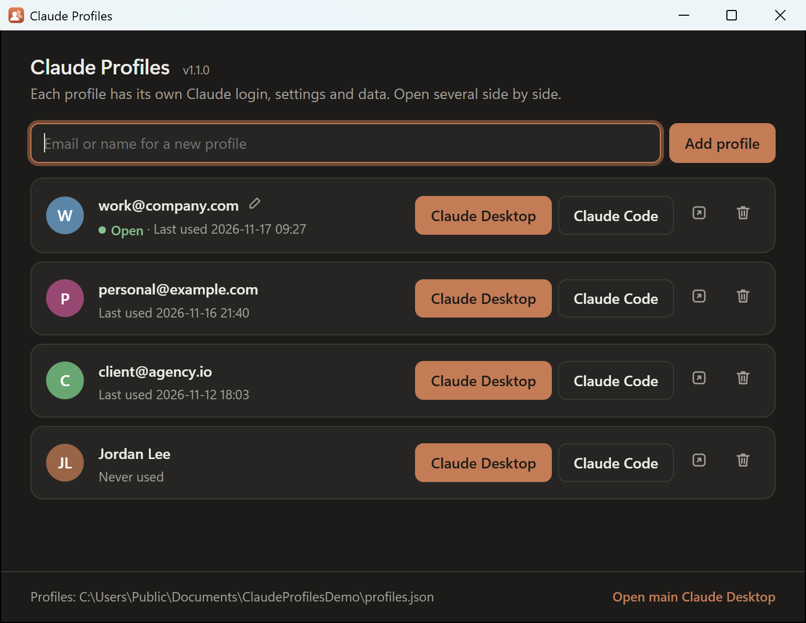
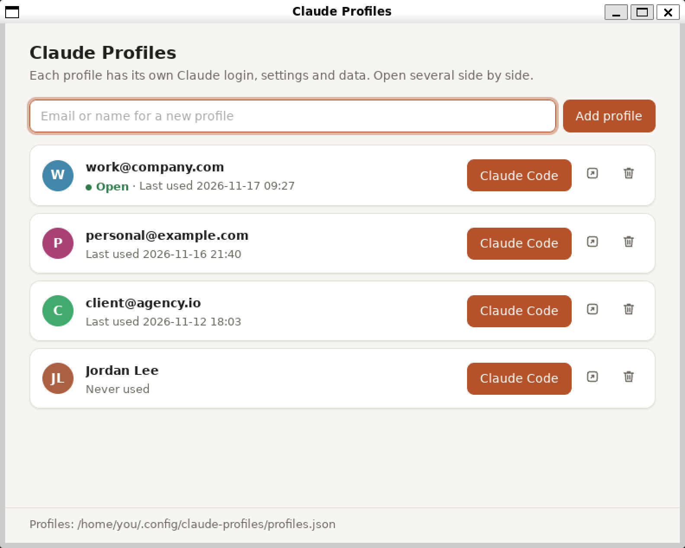
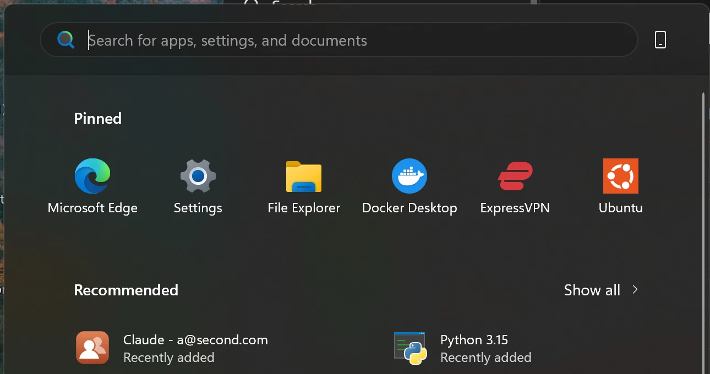

# Claude Desktop & Claude Code Multiple Accounts — Profile Switcher for Windows, macOS and Linux

**Run multiple Claude Desktop and Claude Code accounts side by side on one computer.** Claude Profiles gives every Claude account its own isolated profile — separate login, settings, MCP servers and data — for both the Claude Desktop app and the Claude Code CLI, so you can switch between work and personal Claude accounts (or several team accounts) without ever signing out.

[](https://github.com/HadiAghandeh/ClaudeMultiUser/releases/latest)
[](https://github.com/HadiAghandeh/ClaudeMultiUser/actions/workflows/ci.yml)

<p align="center">
  
</p>

> Keywords: Claude Desktop multiple accounts, Claude Code multiple accounts, Claude Code switch account, `CLAUDE_CONFIG_DIR`, Claude multi-user, Claude profile manager, switch Claude accounts, run two Claude Desktop instances, Claude Desktop Windows, Claude Desktop macOS, Claude Code Linux, `--user-data-dir`, Claude shortcut per account, Go CLI.

---

## Table of contents

- [Why use this](#why-use-this)
- [Platform support](#platform-support)
- [Features](#features)
- [Installation](#installation)
- [Using the window app](#using-the-window-app)
- [Using the terminal app](#using-the-terminal-app)
- [Claude Code profiles](#claude-code-profiles)
- [Desktop shortcuts per account](#desktop-shortcuts-per-account)
- [How it works](#how-it-works)
- [Where data is stored](#where-data-is-stored)
- [Building from source](#building-from-source)
- [FAQ](#faq)
- [Troubleshooting](#troubleshooting)
- [Disclaimer](#disclaimer)

## Why use this

Claude Desktop and Claude Code sign in to one account at a time. If you have a personal Claude Pro account and a company Claude Team or Enterprise account, you normally have to log out and back in every time you switch. Claude Profiles launches each account with **its own data folder**, so all your accounts stay signed in and can run at the same time:

- **Claude Desktop** opens in its own window per account.
- **Claude Code** runs with its own config folder per account, so `claude` uses the right login, settings, MCP servers and history.

## Platform support

| | Windows 10/11 | macOS | Linux |
| --- | :---: | :---: | :---: |
| Terminal app (`claude-profiles`) | ✅ x64, ARM64 | ✅ Intel, Apple Silicon | ✅ x64, ARM64 |
| Window app (`claude-profiles-gui`) | ✅ x64, ARM64 | — use the terminal app | ✅ x64 |
| Claude Desktop profiles | ✅ | ✅ | only with an unofficial build¹ |
| Claude Code profiles | ✅ | ✅ | ✅ |
| Desktop and menu shortcuts | ✅ Start menu | ✅ Applications folder | ✅ app menu |
| "Open" status for Claude Desktop | ✅ | ✅ | ✅¹ |

¹ Anthropic doesn't publish Claude Desktop for Linux. If you use a community build that installs a `claude-desktop` command, Claude Profiles picks it up; otherwise the Linux app manages Claude Code profiles only.

> macOS support is new: it's built and checked by CI on every change, but hasn't been tried on a real Mac yet. Reports are welcome in [Issues](https://github.com/HadiAghandeh/ClaudeMultiUser/issues).

<p align="center">
  
  <br><sub>The window app on Linux. Without Claude Desktop installed it shows Claude Code only.</sub>
</p>

## Features

- 🧑‍🤝‍🧑 **Multiple Claude accounts at once** — each profile opens in its own window or terminal.
- 🖼️ **Window app** — lists your profiles with one-click **Claude Desktop** and **Claude Code** buttons, a folder picker, and light/dark mode (Windows and Linux).
- 💻 **Terminal app** — an interactive menu and command-line flags; on macOS and Linux it runs Claude Code right in your current terminal.
- 🚀 **Desktop and menu shortcuts per account** — one click creates a shortcut like `Claude - work@company.com` or `Claude Code - work@company.com`, so each account opens straight from the Desktop, the Start menu / Applications folder / app menu, or system search. Removing a profile removes its shortcuts. [See how ↓](#desktop-shortcuts-per-account)
- 📂 **Recent project folders** — each profile remembers its last 5 Claude Code folders and offers them in one click (or by number in the terminal).
- 🟢 **See what's open** — profiles with Claude Desktop running are marked **Open**, updated live in the window (and with `*` in the terminal menu).
- ✏️ **Rename profiles** — change a profile's email or name without signing out; its data stays put and its shortcuts are renamed to match.
- 🔒 **Fully isolated profiles** — separate login session, cookies, settings, MCP servers and cache.
- 🔍 **Auto-discovery** — existing profile folders on disk are picked up automatically.
- 🪶 **No dependencies** — a single executable per platform (the Linux window app needs WebKitGTK).
- 📦 **Prebuilt releases** — for every platform on [GitHub Releases](https://github.com/HadiAghandeh/ClaudeMultiUser/releases).

## Installation

Download the archive for your system from the [latest release](https://github.com/HadiAghandeh/ClaudeMultiUser/releases/latest). You also need [Claude Desktop](https://claude.ai/download) and/or [Claude Code](https://docs.claude.com/en/docs/claude-code/setup).

### Windows

1. Download `claude-profiles_<version>_windows_amd64.zip` (or `_arm64` for ARM PCs) and unzip it to a folder of your choice.
2. Double-click **`claude-profiles-gui.exe`** for the window app, or run `claude-profiles.exe` in a terminal.

The window app needs the Microsoft Edge WebView2 Runtime, which Windows 11 and up-to-date Windows 10 already include. Claude Code opens in a Windows Terminal tab when Windows Terminal is installed, otherwise in a PowerShell window.

> Coming from the old PowerShell script? Put the `.exe` files in the same folder as your `profiles.json` — they read the same file, so all your profiles carry over.

### macOS

1. Download `claude-profiles_<version>_darwin_arm64.tar.gz` (Apple Silicon) or `_darwin_amd64.tar.gz` (Intel).
2. Extract it and move `claude-profiles` somewhere on your `PATH`:
   ```bash
   sudo mv claude-profiles /usr/local/bin/
   ```
3. The binary isn't signed by Apple, so the first run may be blocked. Allow it once with:
   ```bash
   xattr -d com.apple.quarantine /usr/local/bin/claude-profiles
   ```
4. Run `claude-profiles`.

### Linux

1. Download `claude-profiles_<version>_linux_amd64.tar.gz` (or `_arm64`, terminal app only) and extract it.
2. Move the programs onto your `PATH`, e.g.:
   ```bash
   install -m 755 claude-profiles claude-profiles-gui ~/.local/bin/
   ```
3. Run `claude-profiles` in a terminal, or `claude-profiles-gui` for the window. The window needs GTK 3 and WebKitGTK 4.1:
   ```bash
   sudo apt install libgtk-3-0 libwebkit2gtk-4.1-0
   ```
   (Fedora: `sudo dnf install gtk3 webkit2gtk4.1`; Arch: `sudo pacman -S gtk3 webkit2gtk-4.1`.)

To add the window app to your app menu, save this as `~/.local/share/applications/claude-profiles.desktop`:

```ini
[Desktop Entry]
Type=Application
Name=Claude Profiles
Comment=Run several Claude accounts side by side
Exec=claude-profiles-gui
Icon=utilities-terminal
Categories=Development;Utility;
```

## Using the window app

Add a profile by email or name, then click **Claude Desktop** or **Claude Code** next to it and sign in with that account.

- **Claude Code** asks for a project folder: it starts with the profile's most recent one and lists its last 5 under **Recent folders** (click to pick, double-click to start, × to forget). Type a folder or click **Browse…** for another.
- **Open** (green) means Claude Desktop is currently running for that profile.
- **Rename:** hover a name and click the pencil (Enter saves, Esc cancels).
- **Shortcut icon:** creates Desktop and menu shortcuts for that profile.
- **Trash icon:** removes a profile after confirmation (its local data and shortcuts; your conversations stay on your Claude account).
- **Open main Claude Desktop** starts your normal, unmanaged profile.

## Using the terminal app

Run `claude-profiles` (`claude-profiles.exe` on Windows) for the menu:

```text
  Claude - choose a user
  ----------------------
   1)  work@company.com                 * running   last used 2026-11-17 09:27
   2)  personal@example.com             never used

   1, 2, ...   Claude Desktop as that user (* = already open)
  C1, C2, ...  Claude Code as that user (runs in this terminal)

   M)  Main Claude Desktop (your normal profile)
   A)  Add a new user
   N)  Rename a user
   R)  Remove a user
   S)  Create a Desktop / app menu shortcut
   Q)  Quit
```

Or use it directly:

| Command | What it does |
| --- | --- |
| `claude-profiles -profile work@company.com` | Starts that account's Claude Desktop |
| `claude-profiles -profile work@company.com -code` | Starts that account's Claude Code in the current folder |
| `claude-profiles -profile work@company.com -code -dir ~/src/app` | Starts that account's Claude Code in `~/src/app` |
| `claude-profiles -profile work@company.com -shortcut both` | Creates Desktop and menu shortcuts (`desktop`, `start` or `both`; add `-code` for Claude Code) |
| `claude-profiles -profile work@company.com -rename new@company.com` | Renames that profile (it stays signed in; shortcuts are updated) |
| `claude-profiles -list` | Lists all profiles and whether Claude Desktop is running for each |
| `claude-profiles -profiles-file /path/profiles.json` | Uses a different profile list |
| `claude-profiles -version` | Prints the version |

## Claude Code profiles

Every profile works for Claude Code. Launching it sets `CLAUDE_CONFIG_DIR` to that profile's own folder (see [Where data is stored](#where-data-is-stored)), so login, `settings.json`, MCP servers, memory and history are separate per account.

- **macOS and Linux, from a terminal:** Claude Code runs right in that terminal.
- **Windows, or from the window app / a shortcut:** a new terminal opens (Windows Terminal or PowerShell on Windows, Terminal.app on macOS, your default terminal on Linux) titled `Claude Code - <account>`, and stays open after Claude Code exits.
- The folder is added to the profile's recent folders (up to 5, newest first), offered next time; folders that no longer exist are skipped.

The first time you open Claude Code for a profile, run `/login` and sign in with that account. Claude Desktop and Claude Code logins are independent, so sign in to each once.

> Tip: to start a profile from your existing Claude Code setup, copy files such as `settings.json` from `~/.claude` into the profile's Claude Code folder.

## Desktop shortcuts per account

Give each Claude account its own one-click shortcut. In the window app, click the shortcut icon next to a profile, choose **Claude Desktop** or **Claude Code** (with an optional project folder), and tick **Desktop**, the menu, or both. From the terminal, press `S` in the menu or run:

```bash
claude-profiles -profile work@company.com -shortcut both
```

```bash
claude-profiles -profile work@company.com -code -dir ~/src/app -shortcut start
```

Shortcuts are named like `Claude - work@company.com` and `Claude Code - work@company.com`, use the Claude Profiles icon, and are renamed or removed together with their profile.

| | Desktop | Menu |
| --- | --- | --- |
| Windows | `.lnk` on your Desktop (also when OneDrive moves it) | Start menu → **Claude Profiles** folder, ready to pin to Start or the taskbar |
| macOS | small `.app` on your Desktop | `~/Applications/Claude Profiles`, found by Spotlight and Launchpad |
| Linux | `.desktop` launcher on your Desktop (marked trusted on GNOME) | `~/.local/share/applications`, so it appears in your app menu and search |

<p align="center">
  
</p>

Each account gets its own entry — search for its email (e.g. `Claude - a@second.com`) to open Claude as that account in one click. On Windows, shortcuts run `claude-profiles-gui.exe` so no console window flashes; keep the programs where they are after creating shortcuts, or create the shortcuts again after moving them.

## How it works

Claude Desktop is an Electron app, and Electron supports the `--user-data-dir` switch. Claude Profiles starts it with a different data folder for each profile, which gives each one its own independent session:

```text
Windows:  Claude.exe --user-data-dir="%LOCALAPPDATA%\Claude-Data\<profile>"
macOS:    open -n -a Claude --args --user-data-dir="~/Library/Application Support/Claude Profiles/Claude-Data/<profile>"
```

For Claude Code it sets the documented `CLAUDE_CONFIG_DIR` environment variable, which tells Claude Code where to keep its config and credentials instead of `~/.claude`:

```bash
CLAUDE_CONFIG_DIR=~/.local/share/claude-profiles/Claude-Code-Data/<profile> claude
```

**Finding the apps.** Claude Desktop: on Windows the Microsoft Store and installer versions (`%LOCALAPPDATA%\Microsoft\WindowsApps`, `\Programs\Claude`, `\AnthropicClaude`); on macOS `/Applications/Claude.app` or `~/Applications/Claude.app`; on Linux a `claude-desktop` command. Claude Code: `claude` on your `PATH`, plus the usual install locations (`~/.local/bin`, `~/.claude/local`, npm, Homebrew).

**"Open" status.** While Claude Desktop runs it locks a file in its data folder (`lockfile` on Windows, the `SingletonLock` link on macOS/Linux). Claude Profiles checks that lock, which takes one file check per profile.

## Where data is stored

| | Windows | macOS | Linux |
| --- | --- | --- | --- |
| Claude Desktop data | `%LOCALAPPDATA%\Claude-Data\<profile>` | `~/Library/Application Support/Claude Profiles/Claude-Data/<profile>` | `~/.local/share/claude-profiles/Claude-Data/<profile>` |
| Claude Code config | `%LOCALAPPDATA%\Claude-Code-Data\<profile>` | `…/Claude Profiles/Claude-Code-Data/<profile>` | `~/.local/share/claude-profiles/Claude-Code-Data/<profile>` |
| Profile list | `profiles.json` next to the `.exe` | `~/Library/Application Support/Claude Profiles/profiles.json` | `~/.config/claude-profiles/profiles.json` |

`profiles.json` contains your account emails and local paths; it's excluded from git via `.gitignore`.

## Building from source

Requires Go 1.22+.

**Terminal app** (any platform; pure Go, cross-compiles):

```bash
go build -o claude-profiles .
```

**Window app on Windows** (WebView2, no CGO):

```bash
go build -tags gui -ldflags "-H=windowsgui" -o claude-profiles-gui.exe .
```

**Window app on Linux** (WebKitGTK through CGO). Install the headers, then build with the bundled pkg-config alias — [`webview_go`](https://github.com/webview/webview_go) asks for WebKitGTK 4.0, which current distributions replaced with the compatible 4.1:

```bash
sudo apt install gcc pkg-config libgtk-3-dev libwebkit2gtk-4.1-dev
```

```bash
PKG_CONFIG_PATH=$PWD/build/linux/pkgconfig CGO_ENABLED=1 go build -tags gui -o claude-profiles-gui .
```

The window is plain HTML in [`ui/index.html`](ui/index.html), embedded into the program and shown with WebView2 on Windows ([go-webview2](https://github.com/jchv/go-webview2)) and WebKitGTK on Linux.

**App icon:** drawn by [`tools/icongen`](tools/icongen/main.go) into [`winres/`](winres/). On Windows it's embedded with version details through the `rsrc_windows_*.syso` files; macOS and Linux shortcuts use the embedded PNG. After changing the icon or [`winres/winres.json`](winres/winres.json):

```bash
go run ./tools/icongen
```

```bash
go run github.com/tc-hib/go-winres@v0.3.3 make --in winres/winres.json --arch amd64,arm64 --product-version 0.0.0 --file-version 0.0.0
```

**Publishing a release:** [GoReleaser](https://goreleaser.com) builds every platform in GitHub Actions. Push a version tag and the workflow attaches the archives and checksums to a new GitHub release:

```bash
git tag v1.1.0
```

```bash
git push origin v1.1.0
```

## FAQ

**Can I run two Claude Desktop accounts at the same time?**
Yes, on Windows and macOS. Each profile runs as its own Claude Desktop instance with its own window.

**Can I use multiple Claude Code accounts at the same time?**
Yes, on all three systems. Each Claude Code profile has its own `CLAUDE_CONFIG_DIR`, so two accounts can work in parallel.

**Does this affect my normal Claude Desktop or `~/.claude` setup?**
No. Your main Claude Desktop profile is untouched (open it with `M` or **Open main Claude Desktop**), and running `claude` normally still uses `~/.claude`.

**Will removing a profile delete my Claude conversations?**
No. It only deletes the local data folders on this computer. Conversations are stored on your Claude account.

**Is each profile's MCP / `claude_desktop_config.json` separate?**
Yes — every profile has its own data folder, so configuration is per profile.

**Why is there no window app for macOS?**
The terminal app covers macOS fully, including shortcuts that open Claude Desktop or Claude Code per account. A native macOS window may come later.

## Troubleshooting

- **"Claude Desktop was not found"** — install Claude Desktop from [claude.ai/download](https://claude.ai/download). On Linux there's no official build; use Claude Code profiles.
- **"Claude Code was not found"** — install Claude Code and make sure `claude` is on your `PATH`.
- **Claude Code asks me to log in again** — expected the first time for each profile; run `/login` once per profile.
- **Linux: "no terminal app was found"** — install a terminal such as GNOME Terminal or xterm, or set the `TERMINAL` environment variable.
- **Linux: the window doesn't open** — install WebKitGTK (`libwebkit2gtk-4.1-0`), or use `claude-profiles` in a terminal.
- **macOS: "cannot be opened because the developer cannot be verified"** — run `xattr -d com.apple.quarantine` on the binary once (see [Installation](#macos)).
- **A new window opens in the wrong account** — close all Claude windows and launch the profile again.

## Disclaimer

This is an unofficial community tool and is not affiliated with or endorsed by Anthropic. "Claude" is a trademark of Anthropic, PBC.
